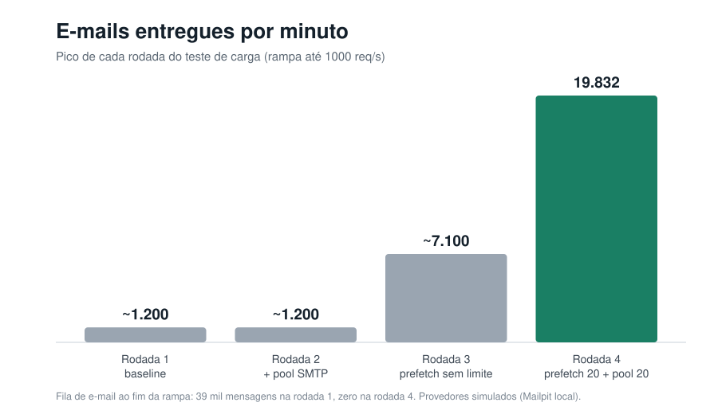
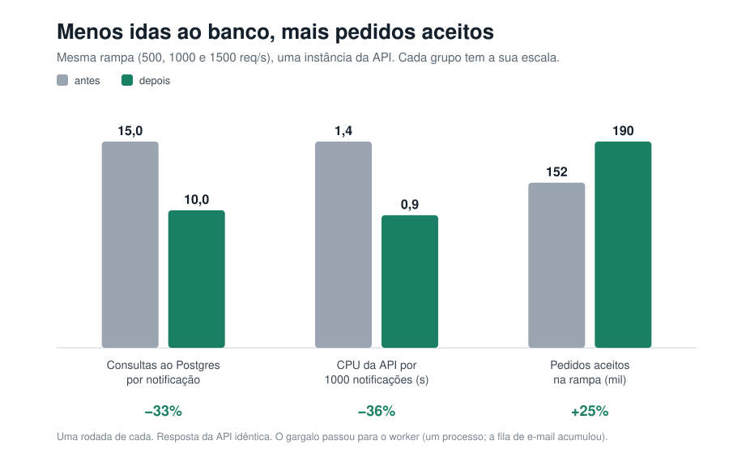

# Notification Gateway

[](https://github.com/niegereis/notifications-project/actions/workflows/ci.yml)

Serviço HTTP que outros sistemas chamam para enviar notificações por **e-mail, SMS ou push**. A API valida o pedido, grava, publica na fila e responde `202`; um worker separado entrega com retry, dead-letter e webhook de desfecho.

**Stack:** Node.js 22 · TypeScript · NestJS · PostgreSQL + TypeORM · Redis · RabbitMQ · Vitest · k6 · Prometheus/Grafana · Docker Compose

## O que ele garante

- **Resposta rápida:** `202` assim que o pedido é gravado e enfileirado; a entrega é assíncrona.
- **Idempotência:** `Idempotency-Key` repete o pedido sem duplicar o envio (`SET NX` no Redis + fingerprint do corpo).
- **Rate limit** por destinatário e canal, não por serviço.
- **Retry e dead-letter:** até 3 tentativas (espera de 1 s e 5 s). Na terceira falha a mensagem vai para a fila morta e pode ser reprocessada (redrive).
- **Isolamento:** cada serviço vê só as próprias notificações (`404`, não `403`).
- **Webhook de desfecho** assinado com HMAC-SHA256.
- **Observabilidade:** métricas Prometheus na API e no worker, dashboard no Grafana.

## Arquitetura

```
cliente ──POST /notifications──▶ API (NestJS) ──▶ 202
                                  │ valida · idempotência e rate limit (Redis)
                                  │ renderiza template · grava PENDING (Postgres)
                                  ▼ publica só o id
                        RabbitMQ  notifications.{email,sms,push}
                                  ▼
                               Worker ──▶ SMTP / Twilio / FCM ──▶ SENT ──▶ webhook
                                  │ falha 1 e 2 ─▶ fila de espera (1 s / 5 s, TTL) ─▶ volta
                                  └ falha 3 ─────▶ notifications.dead ─▶ redrive
```

API e worker são dois processos do mesmo pacote (`backend/`). O conteúdo da notificação fica no Postgres; na fila vai só o id.

## Como rodar

Pré-requisito: Docker e Docker Compose.

```bash
cp .env.example .env
docker compose up -d --build
```

| Serviço | Endereço |
| --- | --- |
| API | http://localhost:3000 |
| Mini-painel | http://localhost:8080 |
| E-mails (Mailpit) | http://localhost:8025 |
| RabbitMQ | http://localhost:15672 (`notifications` / `notifications`) |
| Grafana / Prometheus | http://localhost:3030 / http://localhost:9090 |

As chaves de API do `.env.example` são de desenvolvimento. SMS e push rodam **simulados** (aparecem no log do worker) até você configurar `TWILIO_*` e `FCM_*`.

## Usando a API

```bash
KEY=$(grep ^PANEL_API_KEY .env | cut -d= -f2)

curl -X POST http://localhost:3000/notifications \
  -H "x-api-key: $KEY" -H 'Content-Type: application/json' \
  -d '{"channel":"EMAIL","eventType":"user.welcome","recipient":"ana@exemplo.com",
       "payload":{"nome":"Ana","produto":"Gateway"}}'
```

```json
{ "id": "…", "status": "PENDING", "channel": "EMAIL", "subject": "Bem-vindo(a), Ana!", "attempts": [] }
```

Acompanhe com `GET /notifications/:id` (status e tentativas) e veja o e-mail no Mailpit.

| Endpoint | Para quê |
| --- | --- |
| `POST /notifications` | cria o pedido (`Idempotency-Key` e `callbackUrl` opcionais) |
| `GET /notifications` · `/:id` | lista (filtros e paginação) e detalhe com tentativas |
| `POST /notifications/:id/redrive` · `/dead/redrive` | reprocessa `FAILED` e drena a dead-letter |
| `GET /health` · `/health/ready` | liveness e readiness (Postgres, Redis, RabbitMQ) |
| `GET /metrics` | Prometheus |

Erros principais: `400` corpo inválido · `401` sem chave · `409` mesma `Idempotency-Key` com corpo diferente · `422` sem template ou variável faltando · `429` limite do destinatário (com `Retry-After`) · `503` fila indisponível.

## Decisões de projeto

| Decisão | Por quê |
| --- | --- |
| Só o id vai para a fila; o texto já renderizado fica no Postgres | fila leve, e editar um template depois não altera o histórico |
| Retry com filas de espera (TTL + dead-letter), não `nack` com requeue | requeue imediato inundaria o worker |
| O worker reivindica a notificação com `UPDATE` condicional | duas entregas da mesma mensagem não enviam em dobro |
| Publisher confirms; se o publish falha, o registro vira `FAILED` | nunca fica `PENDING` sem estar na fila |
| Uma linha por tentativa, gravada na mesma transação do status | histórico completo e consistente |
| Provedores atrás de uma interface (`DeliveryProvider`) | o worker não tem `if` por canal |

A entrega é *at-least-once*: se o worker morrer depois do provedor e antes de gravar `SENT`, um segundo envio é possível.

## Desempenho

Teste de carga com k6 (`loadtest/`), uma variável por rodada. Provedores simulados e k6 na mesma máquina do sistema: os números servem para comparar rodadas, não como capacidade absoluta.

| Rodada | O que mudou | Resultado |
| --- | --- | --- |
| 1 | baseline | API aceitou 1000 req/s; fila de e-mail com 39 mil mensagens, ~20 e-mails/s |
| 2 | pool SMTP | sem efeito: o custo não era a conexão (~43 ms por envio) |
| 3-4 | consumo paralelo (`CONSUMER_PREFETCH=20`) | e-mail de ~20/s para ~330/s, fila zerada |
| 5 | rampa até 4000 req/s | teto de uma instância da API em ~1000 req/s |
| 6 | 4 réplicas da API | só +36% no pico: a máquina inteira saturou (CPU 82–95%) |
| 7 | API com 2 consultas em vez de 7 | −33% de consultas, −36% de CPU da API, +25% de pedidos aceitos |





Cada correção moveu o gargalo: worker, API, máquina, worker de novo. A primeira hipótese (pool SMTP) estava errada e foi derrubada pela medição. Uma rodada de cada: os ganhos pequenos (−36% de CPU) têm uma variação que ainda não medi. Método, comandos e ressalvas em [`loadtest/README.md`](loadtest/README.md).

## Testes e CI

- **Unitários** (`npm test`): 123 testes, sem Docker.
- **E2e** (`npm run test:e2e`): 27 testes contra `AppModule`, Postgres, Redis e RabbitMQ reais.
- **Cobertura** (`npm run test:cov`): o CI falha abaixo de 85% (linhas) e 75% (branches).
- **GitHub Actions:** lint sem warnings, testes com cobertura, e2e, build do painel e das imagens Docker.

## Configuração

Copie `.env.example` para `.env`. A API valida o ambiente no boot e para com o nome da variável errada.

| Variável | Default | Uso |
| --- | --- | --- |
| `API_KEYS` | exemplo no `.env.example` | `serviço:chave,...` (obrigatória) |
| `RATE_LIMIT_MAX` / `RATE_LIMIT_WINDOW_SECONDS` | `10` / `60` | limite por destinatário e canal |
| `IDEMPOTENCY_TTL_SECONDS` | `86400` | validade da `Idempotency-Key` |
| `CONSUMER_PREFETCH` | `1` | mensagens em paralelo por fila (1 a 500) |
| `SMTP_POOL_MAX_CONNECTIONS` | `max(5, prefetch)` | conexões SMTP simultâneas |
| `WEBHOOK_SECRET` | vazio | assina o webhook (mínimo 16 caracteres) |
| `TWILIO_*` · `FCM_*` | vazio | provedores reais de SMS e push |

## Estrutura

```
backend/       API + worker (NestJS), migrations, testes
web/           mini-painel (React + Vite)
loadtest/      teste de carga (k6), run-round.sh, gráficos e registro das rodadas
docker/        Prometheus, Grafana, RabbitMQ, balanceador do teste de escala
docs/          referência completa
```

## Mais detalhes

[**Referência completa**](docs/REFERENCIA.md): API endpoint por endpoint, idempotência, rate limit, modelo de dados, topologia do RabbitMQ, retry, webhooks, redrive, métricas, todas as variáveis de ambiente, comandos e solução de problemas.
